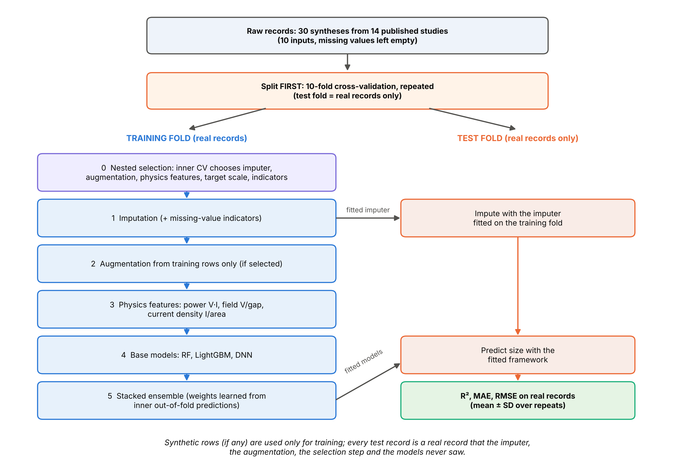
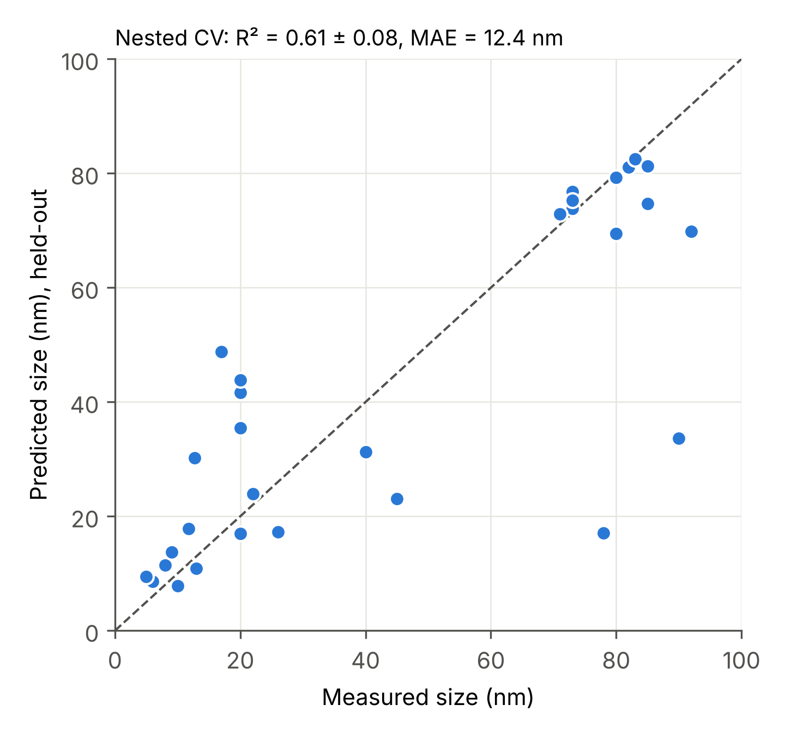

# AgNP Size Prediction

**A leakage-free machine-learning framework for predicting silver nanoparticle (AgNP) size from arc-discharge synthesis conditions.**


This repository contains the data, code, results and figures for the manuscript:

> *A Machine Learning Framework for Silver Nanoparticle Size Prediction: Integrating Autoencoder Imputation, Noise Augmentation, and Stacked Ensemble Learning* (under review).

The framework combines **missing-value imputation → data augmentation (noise or Gaussian copula) → a stacked ensemble of Random Forest, LightGBM and a deep neural network**. Every part that learns from data is fitted on the training fold only, and every test record is a real, unseen literature record.

---

## Highlights

- **Curated dataset:** 30 arc-discharge AgNP syntheses from 14 published studies, with 10 process and solution inputs. Target: particle size (nm).
- **Strict evaluation:** the data are split *before* imputation and augmentation, synthetic rows never reach a test fold, and framework settings are chosen by **nested cross-validation** (72 candidate configurations).
- **Physics-informed features:** arc power (V·I), electric field (V/gap) and current density (I/area).
- **Robustness checks:** leave-one-study-out, y-randomization, learning curves over real records, permutation importance, an imputation masking test and a full ablation.
- **Fully reproducible:** fixed seeds and one script (`run_all.sh`) that rebuilds every table and figure from the raw Excel file.

## Workflow

<p align="center">
  
</p>

## Key results

All metrics are measured on **real held-out records** and reported as mean ± SD over repeated cross-validation.

| Evaluation | Model | R² | MAE (nm) | RMSE (nm) |
|---|---|---|---|---|
| Nested CV, 72 configurations (unbiased) | Stacked ensemble | 0.61 ± 0.08 | 12.4 ± 1.0 | 20.1 ± 2.1 |
| Framework as titled: autoencoder + copula + physics features | Stacked ensemble | 0.67 ± 0.08 | 11.9 ± 1.7 | 18.3 ± 2.2 |
| Original framework, nested CV over 9 configurations | Stacked ensemble | 0.67 ± 0.03 | 12.0 ± 0.5 | 18.6 ± 0.9 |
| Best configuration: mean imputation + physics features, no augmentation | Stacked ensemble | 0.73 ± 0.04 | 10.5 ± 0.7 | 16.7 ± 1.1 |

<p align="center">
  
</p>

**Main findings**

- Arc **voltage** and **current** are the dominant predictors. Post-synthesis quantities (yield, zeta potential) contribute nothing measurable.
- y-randomization: models trained on shuffled sizes reach mean R² = −0.24 (p = 0.032), so the model learns real structure.
- On the current 30 records, augmentation and autoencoder imputation are neutral rather than beneficial (see the ablation, `figures/fig06_ablation.png`). These results are reported transparently.
- With the protocol of the original submission (augment first, then split), test rows are near-copies of training rows and R² rises artificially to ≈ 0.99. The repository reproduces this effect (`figures/fig04_synthetic_vs_real_test.png`) and corrects it.

## Repository structure

```
AgNP-Size-Prediction/
├── code/                     analysis pipeline (run in numeric order)
│   ├── 01_prepare_data.py        raw Excel → 33-record modelling table
│   ├── 01b_clean_v3.py           33 → 30 records (data-quality curation)
│   ├── framework_v3.py           core framework: imputers, augmentation, physics features,
│   │                             base models, stacking, CV and nested selection
│   ├── agnp_pipeline.py          autoencoder imputer and leakage-free utilities
│   ├── 02a–02g_*.py              experiments (nested CV, ablations, robustness, …)
│   ├── 03_make_figures.py        all figures (300 dpi)
│   ├── 04_format_tables.py       paper-ready tables → results/Paper_Tables.xlsx
│   └── 05_minimal_figures.py     figures for the minimally revised manuscript
├── data/                     raw and processed datasets, curation and parsing logs
├── results/                  all result tables (CSV), run logs, Paper_Tables.xlsx
├── figures/                  all manuscript and supplementary figures
├── docs/                     detailed revision report and manuscript-to-file mapping
├── requirements.txt
├── run_all.sh                reproduces the full analysis
└── LICENSE
```

## Installation

```bash
git clone https://github.com/FiloHany/AgNP-Size-Prediction.git
cd AgNP-Size-Prediction
python -m venv .venv
source .venv/bin/activate        # Windows: .venv\Scripts\activate
pip install -r requirements.txt
```

Tested with Python 3.11.

## Reproducing the results

```bash
bash run_all.sh
```

- The full pipeline takes about 2 hours on a 2-core machine; the nested CV takes most of that time.
- Finished stages are skipped. To recompute one table, delete its CSV in `results/` and rerun the corresponding script from `code/`.
- Optional environment variables: `REPEATS` (CV repeats, default 10) and `NPERM` (y-randomization permutations, default 30).

To run a single step (scripts use paths relative to `code/`):

```bash
cd code
python 02c_framework_as_titled.py
```

## Data

| File | Description |
|---|---|
| `data/arc_data_raw.xlsx` | Literature table as collected (33 records) |
| `data/arc_data_paper33.csv` | 33-record modelling table (conventions of the original submission) |
| `data/arc_data_v3_30.csv` | **30-record modelling table used for all main analyses** |
| `data/v3_record_changes.csv` | Records removed or merged, with reasons |
| `data/parsing_notes.csv` | Every non-trivial value conversion (ranges, unit fixes) |
| `data/synthetic_datasets_original.xlsx` | Original augmented sheets (used for comparison only) |

Inputs: current, voltage, yield, zeta potential, pH, temperature, beaker volume, electrode gap and two electrode dimensions. Missing values are left empty and imputed inside each training fold.

## Documentation

- [`docs/REVISION_REPORT.md`](docs/REVISION_REPORT.md): every methodological change, full result tables, and the mapping from reviewer comments to analyses.
- [`docs/MINIMAL_REVISION_NOTE.md`](docs/MINIMAL_REVISION_NOTE.md): which scripts and result files support each item in the minimally revised manuscript.

## Citation

The manuscript is currently under review. Citation details will be added after publication. Until then, please cite this repository:

```
AgNP Size Prediction, GitHub repository, https://github.com/FiloHany/AgNP-Size-Prediction, 2026.
```

## License

The code is released under the [MIT License](LICENSE). The data were compiled from published literature; please cite the original studies when reusing them.

## Contact

Filopater Hany (machine-learning analysis): [@FiloHany](https://github.com/FiloHany)
